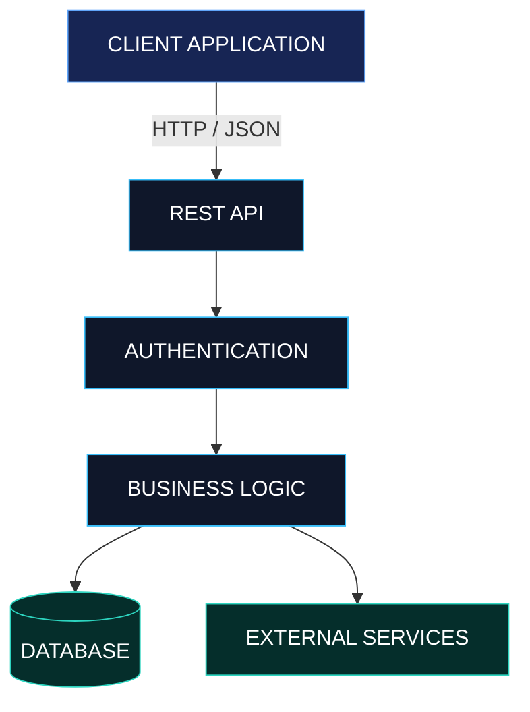

# B A N N A W A T  /  R A T T A N A R A K

**SOFTWARE ENGINEER · BACKEND DEVELOPMENT · GAME SYSTEMS**

`THAILAND` / `RMUTI` / `BUILDING REAL SYSTEMS`

[PORTFOLIO](https://bannawat.site) &nbsp; / &nbsp; [GITHUB](https://github.com/Bannawat01) &nbsp; / &nbsp; [CONTACT](mailto:coach.ra47@gmail.com)

---

## 00 / SYSTEM IDENTIFICATION

```yaml
identity:
  name: Bannawat Rattanarak
  role: Software & Game Developer
  location: Thailand
  education: Rajamangala University of Technology Isan

engineering:
  primary: Backend Development
  secondary: Full-Stack Development
  interests:
    - System Architecture
    - REST API Design
    - Database Engineering
    - Developer Tooling
    - Game Systems

principle: "Design with intent. Build for reality."
```

I develop software across backend services, web applications, and interactive game systems.

My focus is on understanding how systems work, designing clear interfaces between components, and writing maintainable code.

I enjoy transforming ideas into practical applications — from API and database design to game mechanics and developer tooling.

---

## 01 / ENGINEERING DOMAINS

| Domain | Focus | Technologies |
| :--- | :--- | :--- |
| `BE-01` Backend | APIs, services, business logic | Go, Node.js, TypeScript |
| `FE-02` Frontend | Interfaces, application flows | React, Next.js, Tailwind CSS |
| `DB-03` Data | Relational and document databases | PostgreSQL, MongoDB |
| `IN-04` Infrastructure | Containers, deployment, tooling | Docker, Git, Cloudflare |
| `GD-05` Game Systems | Gameplay, interaction, architecture | Unity, Godot, C# |

---

## 02 / SYSTEM ARCHITECTURE

**Reference Architecture / Full-Stack Application**

A simplified blueprint representing the type of architecture I work with and explore.



**Architecture priorities**

- Clear separation of responsibilities
- Predictable API contracts
- Data integrity and validation
- Maintainable service boundaries
- Practical testing and debugging

---

## 03 / TECHNOLOGY MATRIX

```text
LANGUAGES
├── Go
├── TypeScript / JavaScript
├── C#
└── Python

WEB DEVELOPMENT
├── React / Next.js
├── Node.js / Express
├── REST API
└── Tailwind CSS

DATA & INFRASTRUCTURE
├── PostgreSQL
├── MongoDB
├── Docker
├── Git / GitHub
└── Cloudflare

GAME DEVELOPMENT
├── Unity
├── Godot
├── Gameplay Systems
└── Event-Driven Architecture
```

---

## 04 / PROJECT REGISTRY

A selection of development work across backend engineering, applications, and games.

### `PRJ-001` / ALBION API

**Category:** Backend Engineering

An API project focused on working with Albion Online data and service integration.

**Engineering areas**
- API development
- Data retrieval and transformation
- Backend organization

[VIEW SOURCE CODE](https://github.com/Bannawat01/albion-api)

---

### `PRJ-002` / THE ART OF FIGHTING

**Category:** Game Development

A fighting game project exploring combat mechanics, player interaction, and gameplay systems.

**Engineering areas**
- Game mechanics
- Interaction systems
- Gameplay flow

[VIEW SOURCE CODE](https://github.com/Bannawat01/THE-ART-OF-FIGHTING)

---

### `PRJ-003` / TINNER APP

**Category:** Application Development

An application project exploring full-stack integration and software workflows.

**Engineering areas**
- Application structure
- Frontend and backend integration
- User interaction flows

[VIEW SOURCE CODE](https://github.com/Bannawat01/TinnerApp)

---

[OPEN COMPLETE PROJECT REGISTRY](https://github.com/Bannawat01?tab=repositories)

---

## 05 / DEVELOPMENT WORKFLOW


**Process**

1. **Analyze** — Understand the problem, requirements, and constraints.
2. **Design** — Define architecture, data models, and interfaces.
3. **Implement** — Build features in manageable increments.
4. **Validate** — Test expected behavior and edge cases.
5. **Improve** — Refactor, document, and iterate.

---

## 06 / ENGINEERING PRINCIPLES

```text
+----------------------------------------------------------+
|                  ENGINEERING PRINCIPLES                  |
+----------------------------------------------------------+
|  01  CORRECTNESS      Software should behave as expected |
|  02  SIMPLICITY       Avoid unnecessary complexity       |
|  03  MAINTAINABILITY  Optimize for future changes        |
|  04  RELIABILITY      Handle failures deliberately       |
|  05  ITERATION        Improve through evidence           |
+----------------------------------------------------------+
```

I believe effective engineering is not about using the most technologies.

It is about choosing appropriate tools, understanding trade-offs, and delivering software that is useful, understandable, and maintainable.

---

## 07 / CURRENT DEVELOPMENT DIRECTION

| Track | Current Direction |
| :--- | :--- |
| `PRIMARY` | Backend Engineering |
| `ACTIVE` | Full-Stack Applications |
| `EXPLORING` | Distributed Systems & Automation |
| `CREATIVE` | Game Design & Development |
| `IMPROVING` | Architecture, Testing & Documentation |

---

## 08 / COMMUNICATION INTERFACE

```http
GET /developer/contact

200 OK
{
  "name": "Bannawat Rattanarak",
  "location": "Thailand",
  "portfolio": "https://bannawat.site",
  "email": "coach.ra47@gmail.com",
  "collaboration": "open_to_discussion"
}
```

**Connect**

- Portfolio: [bannawat.site](https://bannawat.site)
- GitHub: [Bannawat01](https://github.com/Bannawat01)
- Email: [coach.ra47@gmail.com](mailto:coach.ra47@gmail.com)

---

<p align="center">
  <strong>DESIGN WITH INTENT. BUILD WITH PURPOSE.</strong>
</p>

<p align="center">
  <sub>ENGINEERING BLUEPRINT / BANNAWAT RATTANARAK</sub>
</p>
